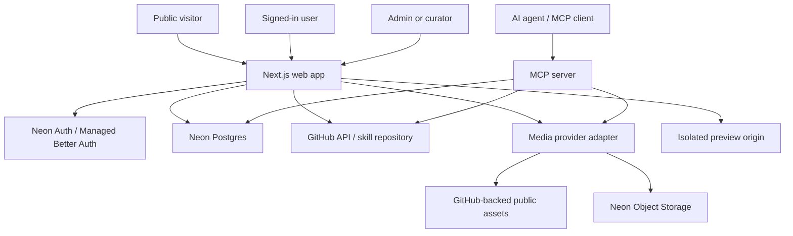

# System Architecture

## 1. Architecture objectives

- Keep the public discovery experience fast, indexable, and resilient.
- Make the skill catalog a structured registry rather than a folder of hard-coded cards.
- Keep identity, catalog metadata, user libraries, and provider credentials separated appropriately.
- Treat GitHub as the canonical versioned source for skill files where configured; use a storage-provider abstraction for visual assets.
- Expose a narrow, read-first MCP interface with stable schemas.
- Make every integration replaceable without coupling UI components directly to its SDK.
- Allow an incremental MVP without requiring every Neon primitive or animation library on day one.

## 2. Recommended stack

Use current stable compatible releases, confirmed during implementation. Exact versions must come from current official documentation and the package manager lockfile.

- Next.js App Router with TypeScript and React.
- Tailwind CSS and shadcn/ui for accessible base components; use Radix primitives through shadcn where applicable.
- Motion for common UI transitions and gesture/layout animations.
- GSAP only for demos needing its timeline/scroll orchestration.
- Three.js / React Three Fiber only inside visual demos that truly need 3D.
- Lottie only for compatible authored animation assets.
- Neon Postgres with Drizzle ORM, using a current supported Neon driver/connection approach.
- Neon Auth / Managed Better Auth following current official Next.js docs.
- Neon Object Storage as a provider option where appropriate; GitHub repository storage remains the default for versioned skill markdown and small curated repository assets if configured by the owner.
- Official MCP TypeScript SDK for the selected protocol/transport.
- Zod or the maintained validation library selected by the project for runtime input validation.
- Vitest (or another established unit runner in the repo) and Playwright for critical end-to-end flows.

Do not install every animation package in the global app just because the product is an animation showcase. The catalog can demonstrate many animation systems as isolated examples; the product shell should remain lean.

## 3. Context diagram



## 4. Logical modules

### 4.1 Presentation

Own route layouts, accessible components, forms, search/filter controls, visual showcases, empty/loading/error states, and responsive navigation. Components should receive typed view models rather than importing database clients or GitHub SDKs.

### 4.2 Application services

Implement use cases such as `searchSkills`, `getPublishedSkill`, `createDraftSkill`, `publishSkill`, `importSkillSource`, `createSignedInCollection`, and `buildInstallCommand`. Application services enforce business rules, call repository/provider interfaces, and return typed outcomes.

### 4.3 Data access

A dedicated data layer owns Drizzle schema queries, pagination, database transactions, and database-specific search logic. UI components and MCP handlers must not issue ad-hoc SQL themselves. The data layer must distinguish published public rows from draft/private rows.

### 4.4 Provider adapters

- `SkillSourceProvider`: read metadata/content from a GitHub repository or supported external source.
- `GitHubWriteProvider`: write/update curated files only when the configured integration has the required permission.
- `AssetStorageProvider`: upload/read/delete public/private assets through the chosen GitHub or Neon Object Storage implementation.
- `IdentityProviderAdapter`: thin boundary around current Neon Auth integration; avoid reimplementing session verification.
- `McpTransportAdapter`: isolate MCP transport initialization from business logic.

Provider interfaces should be small and capability-driven. Do not create elaborate generic frameworks until at least two meaningful implementations require them.

## 5. Next.js route guidance

Use Server Components for read-heavy pages where suitable, metadata, and server-side data loading. Use Client Components only for interactions that require client state, such as a filter panel, preview controls, command copy, or animation. Keep secrets and provider SDKs in server-only modules. Explicitly mark server-only modules using the supported framework conventions and keep client components from importing them.

Recommended route groups may include:

- `app/(public)/...` for public pages.
- `app/(auth)/...` for sign-in and account-auth flows as supported.
- `app/(account)/...` for protected user pages.
- `app/(admin)/admin/...` for protected administration.
- `app/api/...` only for HTTP endpoints that are truly needed. Prefer server actions or route handlers based on current Next.js guidance and the API/MCP requirements; do not duplicate the same use case in both.

Separate metadata and public rendering from admin mutation. Admin forms must call a server-side use case that revalidates session, role, CSRF/origin strategy where applicable, input schema, and target state.

## 6. Suggested code organization

Adapt to the repository if it already has sound conventions. Do not blindly overwrite existing work.

```text
src/
  app/
    (public)/
    (auth)/
    (account)/
    (admin)/admin/
    api/
  components/
    layout/
    navigation/
    skills/
    showcases/
    forms/
    feedback/
    ui/
  features/
    skills/
    categories/
    collections/
    media/
    admin/
    imports/
  lib/
    auth/
    config/
    db/
    validation/
    security/
    observability/
  server/
    services/
    repositories/
    providers/
      github/
      media/
      mcp/
  mcp/
    server.ts
    tools/
    schemas/
  styles/
  tests/
drizzle/
public/
  brand/
```

Only create modules justified by actual use. Do not duplicate the same schema separately for form parsing, API validation, and MCP when they describe the same domain contract; share safe schema modules.

## 7. Data flow examples

### Public skill detail

1. Request reaches `/skills/[slug]`.
2. Route validates and normalizes slug.
3. Application service fetches only published data and relations.
4. Relevant public asset URLs and source metadata are resolved through safe providers.
5. Server renders the detail page with canonical metadata.
6. Live previews load separately within the isolation constraints in document 06.

### Admin publish

1. Admin submits a validated draft.
2. Server verifies current session and role from trusted auth state.
3. Domain validation checks required fields, source provenance, license policy, media state, and command source.
4. Required repository updates are prepared and attempted using a server-side integration.
5. DB state and provider results are coordinated with idempotency/status records; do not claim a distributed transaction across GitHub and Postgres.
6. Audit event is recorded.
7. Public cache/revalidation is triggered only after the published database state is valid.
8. Failure surfaces a retryable status and avoids presenting partial publication as success.

### MCP search

1. MCP request is parsed by the official SDK and the tool input schema.
2. Rate/size limits and access policy are applied.
3. A service searches only visible/public records unless authenticated scopes explicitly permit more.
4. Tool response includes stable IDs, concise metadata, provenance, URLs, and optional content limited to policy.
5. Invalid inputs and provider errors return predictable, non-sensitive errors.

## 8. Neon platform strategy

Neon now offers more primitives than Postgres. Use each deliberately:

- **Postgres:** structured public catalog data, user library data, collections, import jobs, version metadata, and audit records.
- **Managed Better Auth / Neon Auth:** identity and session flows, following the current official integration guide. Do not build a second home-grown identity/session subsystem.
- **Object Storage:** approved uploaded assets or artifacts when its S3-compatible API and public/private access model fit. Keep object keys in Postgres; do not store large binary files in SQL rows.
- **Functions:** optional for long-running ingestion/image tasks if deployment constraints justify it. The MVP may use background-capable jobs or provider-supported execution elsewhere; do not add Neon Functions solely to make the architecture look complete.
- **AI Gateway:** not required for core catalog/auth/search. Consider only for an approved semantic search or AI enrichment feature with budgets, explicit model selection, and privacy review.
- **`neon.ts` infrastructure config:** evaluate it only after verifying current stable syntax, CLI availability, deployment compatibility, and required service access. If used, commit non-secret declarative configuration; never commit populated `.env` files or private credentials.

The official Neon GA statement is dated September 17, 2026. Availability, pricing, region coverage, and SDK details may change; confirm current official documentation before provisioning.

## 9. Search architecture

Start with Postgres-backed filtering and full-text search. Use normalized category/tag relations and indexes matched to actual query patterns. A search request should support a finite page size, stable ordering, and query length limits. Avoid loading the whole dataset into the browser. Add trigram matching, weighted full-text ranking, or an external provider only when testing shows a real need.

Potential later path: embeddings/vector retrieval via Neon/Postgres may improve semantic search, but it needs evaluation data, relevance metrics, costs, and a clear opt-out/privacy policy. Exact/metadata search must remain available if the embedding service is unavailable.

## 10. Caching and revalidation

Public pages may be cached or revalidated based on published records. Draft and admin views must never share a public cache key. Cache invalidation should occur only after successful publication. User-specific favorites and collections must be private and not enter shared public caches. Do not cache auth-sensitive API responses publicly.

## 11. Configuration and error model

Parse and validate environment variables once at server startup or in a typed server-only configuration module. Missing optional integration variables should disable that integration with a clear setup message; missing critical variables in production should fail fast. Use typed domain errors such as `NotFound`, `Forbidden`, `ValidationFailed`, `ProviderUnavailable`, `Conflict`, and `RateLimited`. Return safe public messages and retain correlation IDs for internal diagnostics.

## 12. Architecture decision records

Record major decisions in `docs/decisions/` if the owner wants detailed ADRs. At minimum document:

- Why GitHub is canonical for skill source files.
- Default image/asset provider and public URL strategy.
- Neon Auth integration mode and admin bootstrapping method.
- MCP transport and whether public hosted access requires credentials.
- Preview trust model and permitted embed sources.
- Search engine choice and criteria for future semantic search.
- Hosting, environment strategy, and branch/preview database workflow.
